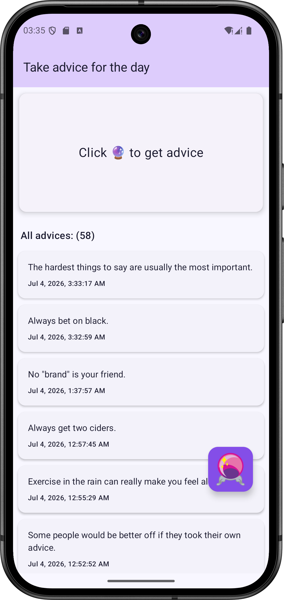
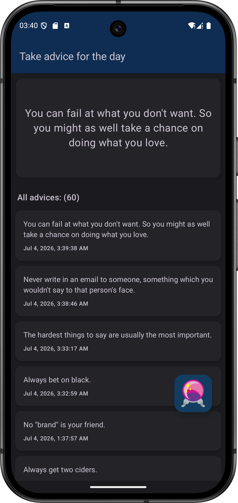
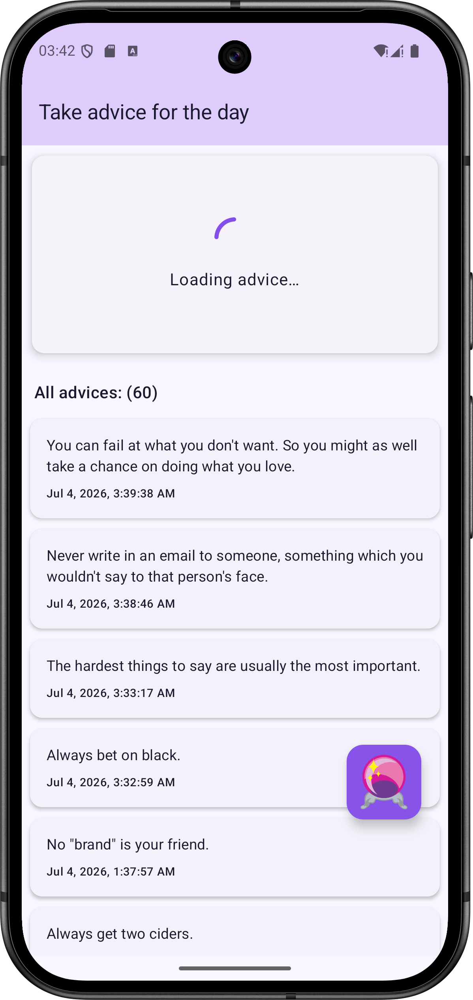
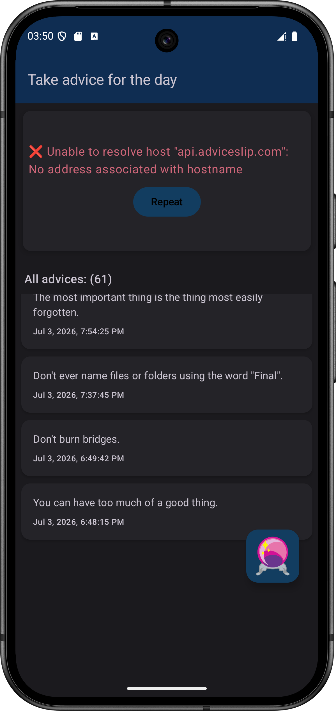
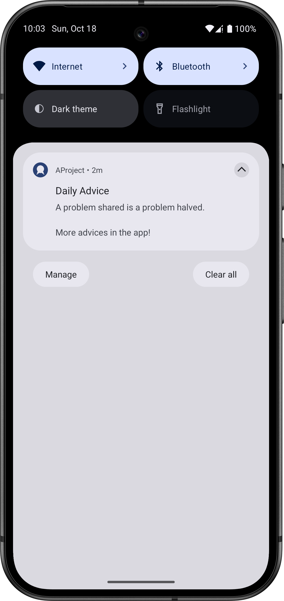
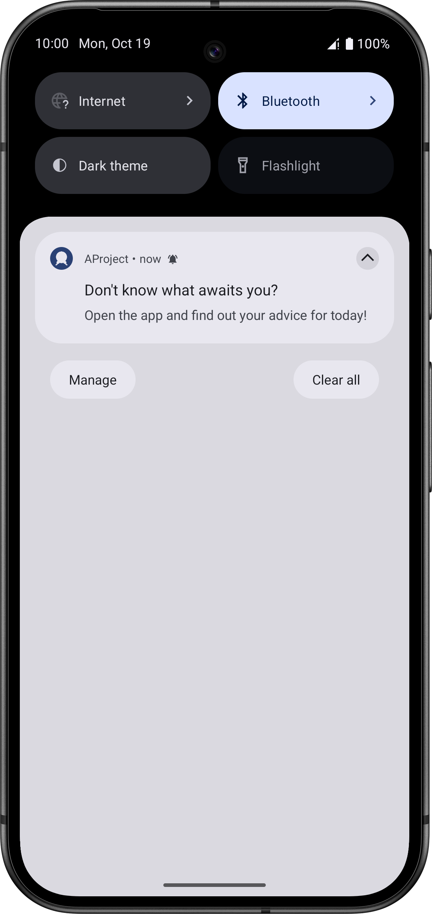

# AProject 🎉

A fun and entertaining Android app that delivers interesting advice from an API, complete with daily notifications to keep you inspired.
Built with a modern Android stack - the project is actively growing, with more fun features on the way.

---

## 🚀 Features

- 🎲 Receive a random piece of advice with a single tap
- 💾 Save your favorite advice for later with **Room Database**
- 🌐 Real-time data from an external API using **Retrofit**
- 🌙 Full **light** and **dark** **theme support**
- 🎨 Clean, modern UI built entirely with **Jetpack Compose**
- 🔔 **Daily Notifications** - receive a new piece of advice every day at 10:00 AM, powered by **WorkManager**
- 🔐 **Notification Permission Onboarding** - smooth and modern system 
dialog request on Android 13+ using **Preferences DataStore**
- 🧩 Modular and scalable architecture ready for new features

---

## 🛠️ Tech Stack

**Language**
- Kotlin

**UI**
- Jetpack Compose

**Architecture**
- MVVM · Repository Pattern · Clean Architecture

**Dependency Injection**
- Dagger Hilt

**Networking**
- Retrofit · OkHttp · Gson

**Local Storage**
- Room Database
- Preferences DataStore

**Background Work**
- WorkManager · HiltWorkerFactory · CoroutineWorker

**Tools**
- Android Studio · Git · Gradle

---

## 🔔 WorkManager & Notifications

The app uses **WorkManager** to schedule a periodic background task that runs daily at **10:00 AM**.

- **When the internet is available:** The Worker fetches a new piece of advice from the API, saves it to the local database, and displays a notification with the advice text.
- **When there is no internet (or an API error occurs):** The Worker catches the exception and displays a fallback notification inviting the user to open the app and get their advice manually.
- **Clicking the notification:** Opens the app directly to the main Advice screen.
- **Expandable text:** Notifications use `BigTextStyle`, so long advice texts are displayed correctly when the user expands the notification.
- **Error handling:** The Worker uses `Result.success()` with a fallback notification to ensure users are always notified, regardless of network conditions.

## 🔐 Permissions & Onboarding

The app requests the `POST_NOTIFICATIONS` permission on Android 13+.

- **State Persistence:** The result of the request is stored in **Preferences DataStore**. This ensures the dialog is 
shown only once and respects the user's choice on subsequent launches.
---

## 📸 Screenshots

### Advice Screen States

|                  Light Theme                  |                 Dark Theme                  |
|:---------------------------------------------:|:-------------------------------------------:|
|  |  |

|                   Loading State                   |                           Connection Error & List End                            |
|:-------------------------------------------------:|:--------------------------------------------------------------------------------:|
|  |  |

### Notifications

| Advice Notification (Online) | No Internet Notification (Offline) |
|:----------------------------:|:----------------------------------:|
|  |  |

> **Note:** The screenshots show the expandable notification with `BigTextStyle` for long advice texts.

---

## 🚀 Setup & Installation

1. Clone the repository:
   ```bash
   git clone https://github.com/Elige23/AProject.git
    ```
2. Open the project in Android Studio
3. Sync Gradle files
4. Run on emulator or physical device

---

## 📄 License
This project is licensed under the MIT License - see the [LICENSE](LICENSE) file for details.

---

## 📞 Contact
- **Email:** kazlova.viktoryia@gmail.com
- **LinkedIn:** [Viktoryia Kazlova](https://www.linkedin.com/in/viktoryia-kazlova/)